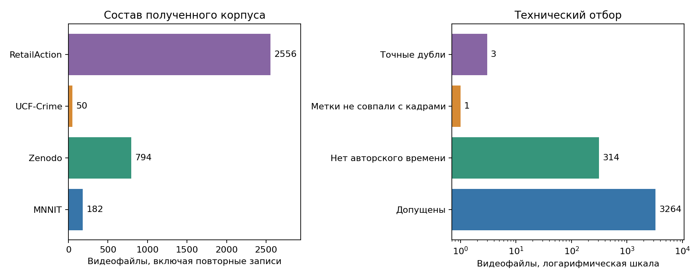
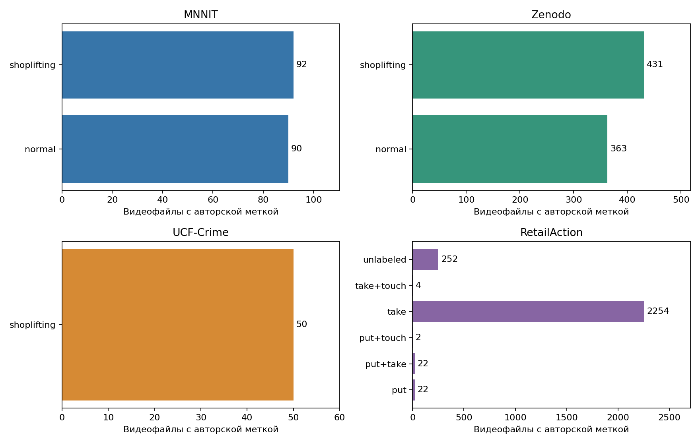
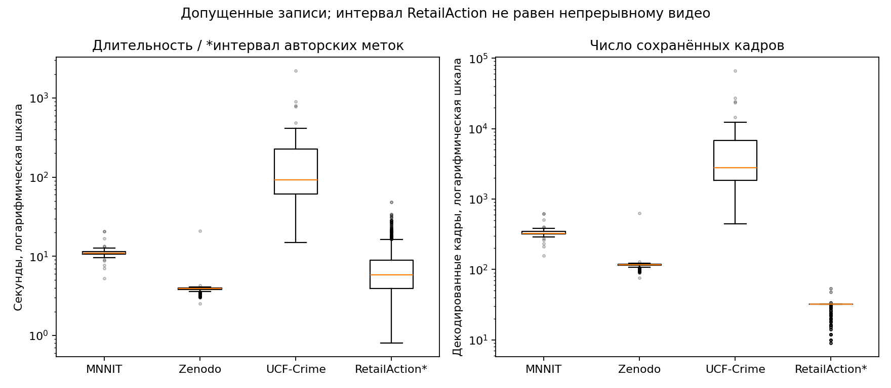
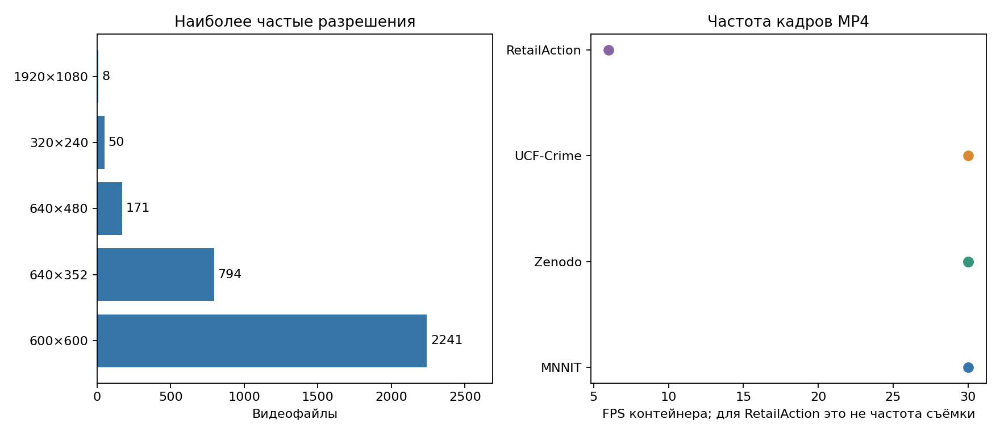
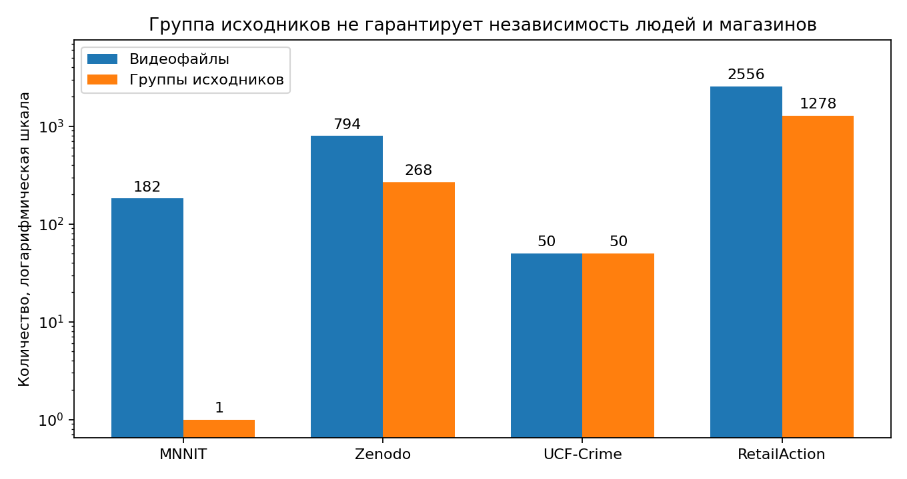

# EDA видеоданных для обнаружения сокрытия товара

## Что анализируем

Цель — проверить состав и техническое качество доступного корпуса, понять ограничения разметки и выбрать данные для будущей ручной/VLM-разметки. В этом отчёте нет результатов распознавания или сравнения моделей.

Количественный анализ выполнен по [локальному снимку метаданных](video_metadata.csv): 3582 записи видео, включая дубли и исключения. Дополнительно проведён [визуальный разбор](visual_review.md) 32 кадров из 8 видео и перепроверены параметры 35 исходных файлов. Полные видео сюда не включены. Основной скрипт воспроизводит статистику и графики по метаданным; выборочные проверки не заменяют аудит всего корпуса.

[Описание источников и контрольные суммы](sources.json) · [Числовая сводка](summary.json).

## 1. Состав и объём

| Источник | Получено видео | Допущено технически | Группы исходников | Объём полученных файлов, GiB |
|---|---:|---:|---:|---:|
| MNNIT | 182 | 179 | 1 | 0.711 |
| Zenodo | 794 | 794 | 268 | 0.875 |
| UCF-Crime Shoplifting | 50 | 50 | 50 | 2.468 |
| RetailAction | 2556 | 2241 | 1278 | 1.470 |

Всего: 3582 файла, 3264 допущены к дальнейшему отбору. Объём включает повторные/связанные записи и не равен объёму независимых наблюдений. RetailAction представлен частью корпуса, а UCF-Crime — только категорией Shoplifting; выводы не распространяются на полные датасеты.



**Вывод:** корпус сильно смещён в сторону RetailAction. Нельзя оценивать качество одной общей долей правильных ответов: источники нужно показывать отдельно, а будущую целевую выборку подбирать по сценам и действиям.

## 2. Классы и пригодность разметки



В MNNIT — 90 Normal / 92 Shoplifting, в Zenodo — 363 / 431. Полученная часть UCF-Crime содержит только Shoplifting. В RetailAction преобладает `take` (2254 файла из 2556), есть возврат и комбинации действий, 252 файла имеют метку `unlabeled`. Отдельного класса `touch` без других действий в этом снимке нет.

**Вывод:** авторские классы нельзя объединить в одну готовую целевую переменную. `take` не означает сокрытие, а Shoplifting не задаёт точные границы помещения предмета. В снимке нет проверенных целевых меток сокрытия: для оценки моделей нужен отдельный ручной эталон. `unlabeled` и отсутствие события в аннотации не означают отрицательный класс.

VLM можно использовать для предразметки обучающей части: предложить действие, границы и участника, затем проверить человеком. Тестовые метки должны формироваться независимо от её ответов.

## 3. Техническое качество

По сохранённым статусам все 3582 файла декодируются. Исключены 3 точные повторные копии; у 314 видео RetailAction отсутствуют авторские времена, ещё у одного не совпадает число кадров и меток. Эти 315 записей нельзя молча анализировать с подстановкой FPS контейнера вместо времени съёмки. Оригинальные записи не считаются повреждёнными только из-за отсутствия такой разметки времени.

В снимке есть 8 записей MNNIT с разрешением 1920×1080 и 27 записей RetailAction с числом кадров больше 32, из них 8 допущены по остальным техническим условиям. Повторное чтение всех 35 файлов подтвердило разрешение, число кадров и совпадение хешей. [Результаты проверки](source_checks.json). Эти особенности не меняют рассчитанную статистику; происхождение версии и пригодность содержания оцениваются отдельно.

**Вывод:** для временной оценки используем согласованные метаданные. Исправление или восстановление времени требует отдельной проверки. Отдельно ещё нужны визуальный отбор, поиск похожих перекодированных повторов и контроль авторских меток; технический аудит их не заменяет.

## 4. Длительность и число кадров



| Источник | Наиболее частое разрешение | Медиана кадров | Медиана длительности / интервала меток, с |
|---|---|---:|---:|
| MNNIT | 640×480 | 327 | 10.90 |
| Zenodo | 640×352 | 117 | 3.90 |
| UCF-Crime Shoplifting | 320×240 | 2769.5 | 92.32 |
| RetailAction | 600×600 | 32 | 5.80 |

Таблица и график характеристик рассчитаны на допущенных записях. Для RetailAction показан интервал между первым и последним выбранными кадрами по авторскому времени. Это не длительность непрерывно записанного или проанализированного видео. Для остальных источников приведена длительность видеофайла. Шкала графика логарифмическая, отдельные точки — выбросы.

**Вывод:** нужны разные правила подготовки окон. На длинных записях требуется временная локализация, а на разреженных — анализ последовательности с исходными метками. Размер MP4 и его длительность не позволяют оценить полноту наблюдения быстрого действия.

## 5. Разрешение и FPS



У RetailAction контейнер имеет 6 FPS, но кадры отобраны из исходной записи; это не частота съёмки. Другие источники в основном имеют около 30 FPS. Разрешения и количество деталей различаются: например, наиболее частый размер полученных UCF-видео — 320×240.

**Вывод:** единый шаг выборки кадров без учёта источника может потерять действие. Разрешение само по себе не доказывает видимость мелкого товара: её нужно проверять на примерах. Способ уменьшения кадра и использования области взаимодействия выбирается после такого просмотра.

## 6. Группы и риск утечки



Группы объединяют связанные исходные записи, а не обязательно независимые магазины или людей. MNNIT оставлен одной лабораторной группой, Zenodo объединяет фрагменты исходных записей; у RetailAction два ракурса одного эпизода имеют общую группу. 1278 эпизодов RetailAction представлены 2556 видео.

**Вывод:** делить нужно исходные группы до нарезки окон и авторазметки. Фрагменты и ракурсы одного события остаются в одной части. Число файлов нельзя использовать как число независимых примеров; для заявления о переносе на новые магазины нужна отдельная проверка происхождения сцен.

## 7. Визуальная пригодность для задачи

В [разборе исходных кадров](visual_review.md) показаны восемь видео четырёх источников: офисные отрицательные примеры, мелкие товары, естественные перекрытия, несколько участников и два ракурса одного эпизода. Выбор сделан без ответов моделей; авторские классы не переименованы в проверенные метки сокрытия. Лица скрыты, номера кадров и происхождение сохранены в локальном манифесте.

**Вывод:** для целевой разметки нужно просматривать полное действие, фиксировать участника и достаточность видимости предмета. Офисные отрицательные примеры не заменяют сложные обычные действия покупателя. Эти иллюстрации не измеряют распространённость проблем во всём корпусе.

## 8. Сколько разметки нужно дальше

[План разметки](annotation_plan.md) задаёт стартовый объём 200 интервалов: 50 для примеров, 50 для валидации, 100 для теста. Тест — 50 сокрытий и 50 обычных действий. Статистическое обоснование, предпосылки независимости и правила добора указаны отдельно. Это дополнительная целевая разметка, а не требование скачать 200 новых видео.

## Что следует из EDA

- Сначала определить наблюдаемое сокрытие и проверить пригодные положительные и обычные действия, затем готовить разметку.
- VLM-разметку хранить как предварительную; контролировать её человеком и отдельно измерить качество на ручной выборке.
- Тестовую часть размечать независимо, не использовать её для настройки модели или инструкции.
- Отчитываться по источникам, сценам и условиям видимости. Технически пригодный корпус ещё не является готовым обучающим набором.

## Воспроизведение

Из корня текущего репозитория, Python 3.10+:

```bash
python -m pip install -r docs/eda/requirements.txt
python docs/eda/analyze.py
python docs/eda/visualize_samples.py
python docs/eda/annotation_plan.py
```

[Анализ метаданных](analyze.py) пересобирает пять графиков и сводку; [визуализация кадров](visualize_samples.py) — четыре иллюстрации; [расчёт разметки](annotation_plan.py) — плановый объём и статистический ориентир. Все используют локальные файлы. Исходные видео не нужны для пересборки; повторное декодирование требует самих видео. Идентификаторы и хеши сохранены, пути к исходным файлам в материалы не включены.
