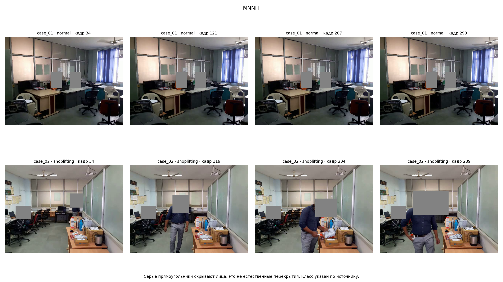
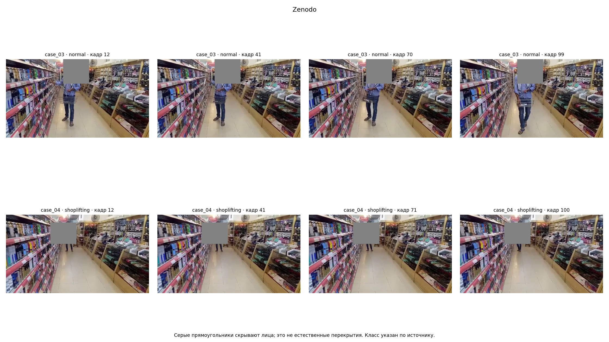
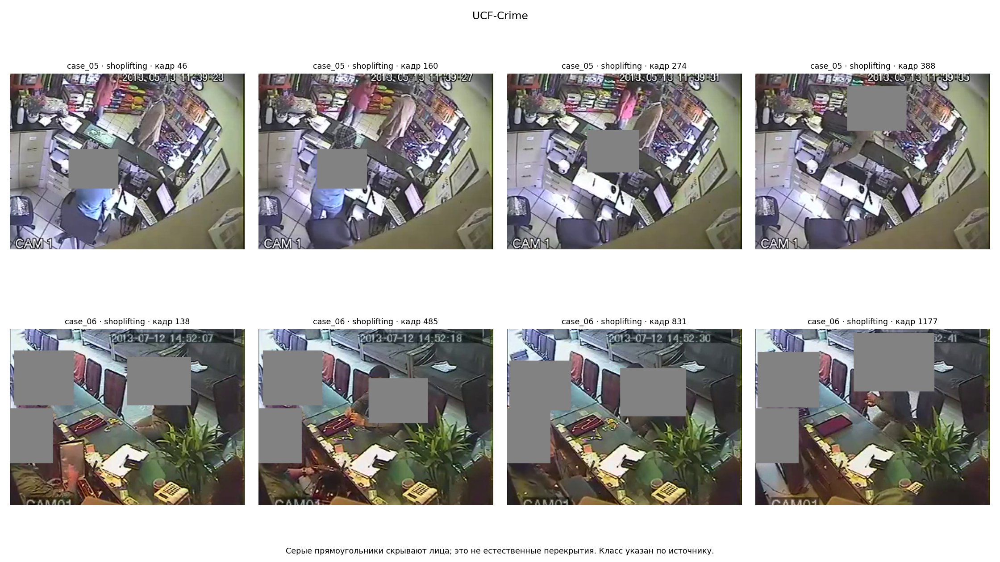
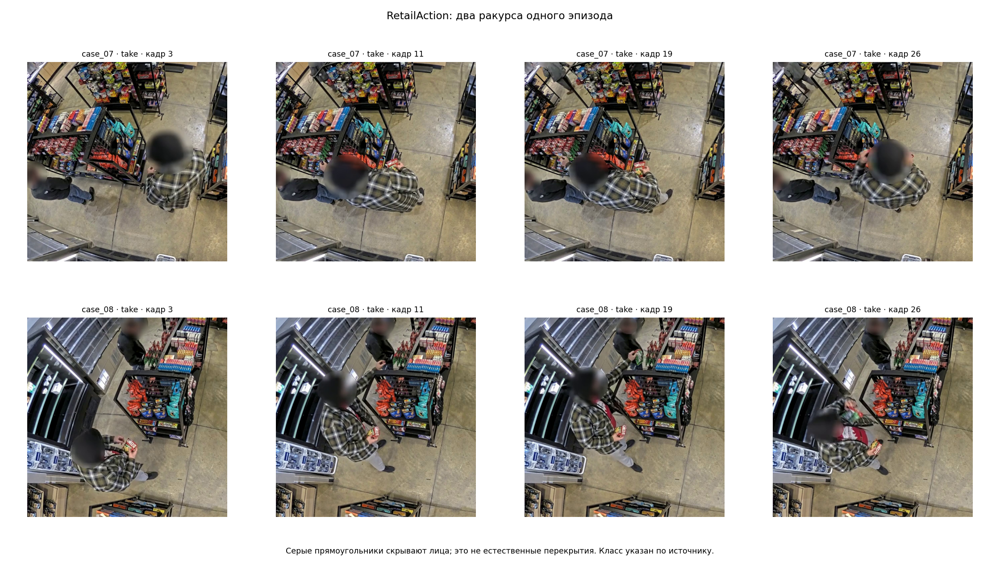

# Визуальный разбор исходных кадров

Просмотрены 32 кадра из 8 видео четырёх источников. Это пять исходных групп: лабораторные ролики MNNIT объединены, два фрагмента Zenodo связаны, два ракурса RetailAction относятся к одному эпизоду.

Видео выбраны по источнику, авторскому классу и хешам до визуальной оценки. В каждом взяты кадры на 10%, 35%, 60% и 85% диапазона кадров; ответы моделей и целевые аннотации не использовались. Хеши восьми исходных файлов совпали с метаданными.

Это качественные примеры, а не случайная выборка для оценки частоты проблем и не разметка событий. Четырёх кадров недостаточно для подтверждения или отрицания сокрытия. Показанные группы уже просмотрены и не могут считаться нетронутым тестом.

В иллюстрациях добавлены серые прямоугольники в области лиц. Они не являются естественным перекрытием и не используются как свидетельство невидимости товара. Для RetailAction сохранено исходное размытие. Номера кадров, происхождение и изменения изображения записаны в [локальном манифесте](visual_samples.json).

## MNNIT: постановка и простые отрицательные примеры



- `case_01`: офисная сцена с двумя сидящими людьми. На выбранных кадрах нет взаимодействия с магазинной выкладкой. Такой отрицательный пример проще обычного действия покупателя с сумкой и не должен доминировать в тесте.
- `case_02`: передний участник взаимодействует с предметами на столе; небольшой предмет различим на части кадров. Другой человек остаётся в фоне. Авторская метка Shoplifting не определяет нужного участника и границы действия.

**Вывод:** лабораторная сцена полезна для начала, но не заменяет магазинное CCTV. Нужны сложные отрицательные действия и явная привязка события к человеку.

## Zenodo: размер предмета и расстояние



- `case_03`: различимы человек, полка и корзина; руки и мелкие предметы занимают небольшую часть кадра. Положение руки около полки само по себе не подтверждает взятие или сокрытие.
- `case_04`: человек дальше от камеры; на общем плане трудно различить предмет и детали движения кисти. Из этих кадров нельзя уверенно установить помещение товара.

**Вывод:** для разметки нужен временной контекст и контроль видимости предмета. Увеличение области изображения не восстанавливает отсутствующие детали; сомнение нужно сохранять, а не заменять уверенной меткой.

## UCF-Crime: несколько участников и перекрытия



- `case_05`: в сцене несколько людей; прилавок, монитор и предметы закрывают часть взаимодействий. Сам факт присутствия человека у кассы не определяет его роль в событии.
- `case_06`: взаимодействие происходит через прилавок; руки частично перекрываются телом и обстановкой. На соседних кадрах меняется видимость деталей, поэтому выбранный участник должен сохраняться во времени.

**Вывод:** оценивать нужно событие конкретного участника. Общий класс клипа и исчезновение предмета за телом не заменяют наблюдаемое помещение товара. Авторская категория Shoplifting здесь не является новой ручной меткой.

## RetailAction: два ракурса и обычное действие



`case_07` и `case_08` показывают один эпизод с разных камер. Различаются видимость рук, предметов и участников; часть деталей закрывается телом или выкладкой. В кадре присутствует второй человек. Упаковка различима лишь в некоторых положениях.

**Вывод:** ракурсы дополняют контекст, но не являются независимыми примерами для разделения данных. Авторский Take относится к взаимодействию с товаром и не подтверждает сокрытие. Разреженные кадры нужно связывать по исходным временным меткам.

## Проверка технических отклонений

Отдельно повторно декодированы 35 отмеченных файлов: 8 MNNIT с разрешением 1920×1080 и 27 RetailAction с числом кадров больше 32. Во всех 35 случаях разрешение и число прочитанных кадров совпали с сохранёнными метаданными; контрольные суммы исходников также совпали. [Результаты проверки](source_checks.json).

Это подтверждает параметры этих файлов, но не объясняет различие с описанием набора и не заменяет аудит всего корпуса или проверку лицензий. Нельзя автоматически исключать запись только из-за отличия от типичного разрешения; пригодность для задачи зависит и от содержания.

## Воспроизведение иллюстраций

```bash
python docs/eda/visualize_samples.py
```

[Скрипт](visualize_samples.py) читает локальные кадры со скрытыми лицами и проверяет их хеши. Он пересобирает четыре иллюстрации без исходных видео и внешних репозиториев. Проверка 35 исходников требует самих видео; её сохранённые результаты не выдаются за повторяемое без них декодирование.
