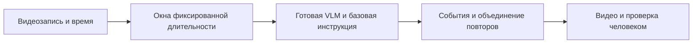
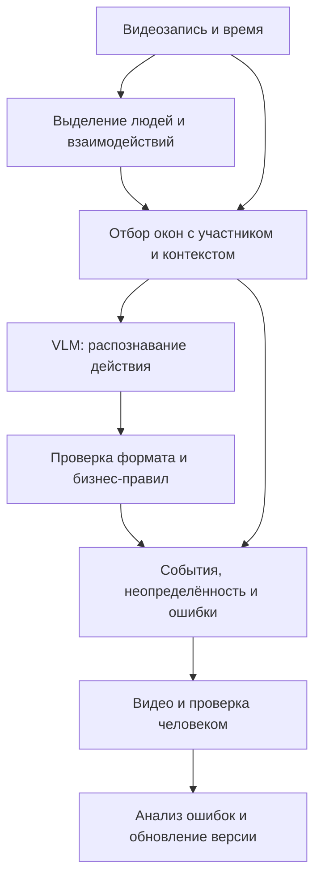

# ML System Design Doc — Видеоаналитика операционных процессов

## Дизайн ML-системы — MVP: обнаружение сокрытия товара

Документ описывает дизайн и дальнейшую проверку решения. Подтверждённые сведения о данных собраны в [EDA](eda/README.md). Прототип обработки и исследовательские запуски моделей существуют; независимую оценку всей цепочки ещё предстоит провести.

## 1. Цели и предпосылки

### 1.1. Зачем идём в разработку продукта?

**Бизнес-цель:** сократить время поиска и проверки эпизодов возможного сокрытия товара. Сейчас сотрудник наблюдает за камерами или ищет событие в архиве. Система должна предложить фрагмент, указать участника и описать видимое действие; решение о реакции принимает человек.

ML планируется использовать для анализа последовательности действий. Визуально-языковая модель (VLM) рассматривается как средство предварительной разметки и распознавания сокрытия. Gemini — один из кандидатов, окончательный выбор будет сделан после проверки качества и затрат.

**Успех итерации:** воспроизводимый бейзлайн, сравнение с основным решением и проверка полезности для пользователя. Измеряем качество событий, ложные сигналы и время проверки. Снижение товарных потерь пока является гипотезой.

### 1.2. Бизнес-требования и ограничения

| ID | Требование | Планируемое покрытие |
|---|---|---|
| БТ-1 | Загрузить запись и задать параметры анализа | Обработка файлов, настройка зон при необходимости |
| БТ-2 | Находить признаки сокрытия и указывать участника и время | Основной сценарий MVP |
| БТ-3 | Показывать основание сигнала и видео для проверки | Карточка события с контекстом |
| БТ-4 | Выделять эпизоды, требующие внимания | Лента событий; недостаток информации отмечается отдельно |
| БТ-5 | Сохранять оценку пользователя и комментарий | Ручная проверка и анализ ошибок |
| БТ-6 | Выгружать результаты и знать качество версии | Отчёт, параметры обработки и версии моделей |
| БТ-7 | Работать с IP-камерами | Следующая итерация после проверки на записях |

**Ограничения:** видео не доказывает неоплату или намерение; камеры анализируются независимо; перекрытие объекта не подтверждает сокрытие. Внешняя VLM требует проверки условий передачи данных, стоимости и задержки. Оборудование, число потоков, бюджет и допустимая нагрузка на сотрудника уточняются до пилота.

**Процесс пилота:** сотрудник получает найденные эпизоды, смотрит видео и отмечает правильность результата. Сравниваем поиск с системой и ручной просмотр на сопоставимых заданиях. Конкретные пороги качества и времени согласуются с владельцем продукта (PO) до итоговой оценки.

**Предварительные ориентиры для проверки:** event recall не ниже 0,50 и хотя бы одно ложное подтверждение не более чем на 20% обычных тестовых интервалов. При сопоставлении событий предлагаем tIoU ≥ 0,5 и совпадение участника; неподтверждённое или неопределённое событие учитывается как пропуск для recall. Неопределённые ответы отдельно показываем для обоих классов. Это стартовые гипотезы, а не результаты, прогноз или утверждённые условия приёмки; их согласуют до итогового теста с учётом ошибок и нагрузки проверяющего.

На сбалансированном тесте из 30 сокрытий и 30 обычных действий оцениваем эти показатели с неопределённостью, а также event precision и F1 только для состава этой выборки. Она не отражает естественную частоту сокрытий. Для оценки ложных сигналов на час и точности уведомлений в реальной работе нужна отдельная проверка на длительных записях с представительной частотой событий.

Для файловой обработки предварительный ориентир — не более 60 секунд на минуту видео. Он не подтверждён замерами и требует согласования; задержка потоковой камеры оценивается отдельно. Фиксируем оборудование, разрешение, настройки обработки, число окон, время сервиса и сети, а также стоимость на минуту исходного видео.

### 1.3. Что входит в скоуп проекта/итерации, что не входит

**Входит:** EDA, подготовка разметки с помощью VLM и человека, бейзлайн обнаружения сокрытия, оценка моделей, просмотр событий и отчёт. Взятие, возврат и касание товара используются как контекст и обычные действия для проверки ложных сигналов.

**Не входит:** доказательство кражи, контроль оплаты без кассовых данных, распознавание личности, межкамерное сопоставление и другие типы инцидентов. Эксплуатация 24/7 и гарантии реального времени отложены до проверки MVP.

**Качество и воспроизводимость:** фиксируем версии данных, разметки, моделей и инструкций, параметры обработки, результаты и ошибки. Код проверяется Ruff и pre-commit. Данные и веса хранятся отдельно от кода.

**Технический долг:** автоматизация сбора и контроля разметки, устойчивое исполнение заданий, усиление защиты и согласование сроков хранения, мониторинг и откат версий. Перед пилотом потребуется независимая проверка на данных целевого магазина.

### 1.4. Предпосылки решения

- Единица анализа — действие человека с предметом во времени. Отдельного кадра может быть недостаточно.
- Авторский класс Shoplifting не равен точной метке сокрытия; нужна проверка события, участника и временных границ.
- В полученном поднаборе RetailAction нет отдельного `touch` без других действий; это ограничение поднабора, а не всего корпуса. Метки обычных действий не заменяют разметку сокрытия ([EDA](eda/README.md)).
- VLM может ускорить разметку, но её ответы не считаются эталоном без контроля человеком.
- Видимость предмета, рук и места помещения влияет на распознавание. При недостатке наблюдений нужен неопределённый ответ.
- Временные метки и связанные ракурсы учитываются при подготовке данных; параметры контейнера не всегда отражают исходную съёмку.

## 2. Методология

### 2.1. Постановка задачи

Планируется распознавать и локализовать во времени видимое помещение товара в сумку, карман или под одежду. Дополнительные способы добавляются после появления подходящей разметки. Подтверждение действия не означает подтверждение нарушения.

**Вход:** видео, временные метки и доступные зоны анализа. **Выход:** тип события, интервал, участник, доступное место помещения, основание решения и видеофрагмент. Различаем подтверждение, отсутствие события и недостаток информации; технические сбои учитываются отдельно.

Бейзлайн для сравнения — готовая VLM на временных окнах с базовой инструкцией. В основном решении рассматриваются автоматический отбор окон, учёт участника и контекста. Прототип отбора окон и исследовательские проверки VLM уже есть, но конфигурация для независимой итоговой оценки ещё не утверждена.

В исследовательском прототипе проверялась [Gemini 3.5 Flash-Lite](https://ai.google.dev/gemini-api/docs/models) на коротких окнах; [Qwen2.5-VL-7B-Instruct](https://huggingface.co/Qwen/Qwen2.5-VL-7B-Instruct) остаётся кандидатом для локального запуска, а не проверенной альтернативой. Пригодность для сокрытия и ресурсы требуют дальнейшей проверки. Доступ к сервису, версию, лицензию и условия применения проверяем перед экспериментом. Сравниваем варианты на одинаковой ручной разметке, фиксируя версию, инструкцию, настройки и способ передачи кадров.

Исследуется дополнительная проверка неоднозначных ответов вторым проходом. Направление окна на просмотр не считается обнаружением события: необходимо сверить действие, участника и время с разметкой. Техническую ошибку не приравниваем к отрицательному ответу.

### 2.2. Блок-схема решения

**Бейзлайн**

**Основной MVP — планируемое развитие**

Схемы показывают варианты проектного решения. Конкретный способ выделения людей и окон выбирается после оценки бейзлайна. Ручная разметка используется для обучения/настройки и оценки, но не подставляется вместо автоматического входа при проверке всей цепочки.

### 2.3. Этапы решения задачи

#### Этап 1. Подготовка данных

##### EDA

В [локальном отчёте](eda/README.md) представлены состав, объём, классы, характеристики видео и проблемы качества. Добавлены графики с выводами, [визуальный разбор исходных кадров](eda/visual_review.md) и скрипты пересборки.

**Вывод по примеру:** видимость рук и товара зависит от ракурса, а обычное взятие товара не подтверждает сокрытие. Два ракурса одного эпизода должны оставаться в одной части данных. Остальные примеры с перекрытиями и несколькими участниками приведены в визуальном разборе.

Снимок метаданных описывает 3582 видео из четырёх источников; по сохранённым статусам после исключения 3 точных дублей и 315 записей с проблемами временных меток остаётся 3264 технически пригодных видео. В репозиторий включены метаданные и примеры кадров со скрытыми лицами, полные видео хранятся отдельно. Просмотр 32 кадров из 8 видео показал простые офисные отрицательные примеры, мелкие/перекрытые предметы и несколько участников. Авторские классы и техническая пригодность не гарантируют видимость целевого сокрытия.

**Целевые переменные**

| Название данных | Есть ли данные / источник | Требуемые роли | Проверено ли качество |
|---|---|---|---|
| Наличие сокрытия и временной интервал | Есть ручная событийная разметка для исследовательских проверок; независимый эталон нужно подготовить | DS, разметчик | Исследовательские метки проверялись; авторская метка не заменяет целевую |
| Участник и место помещения | Для части исследовательских событий размечены; для нового эталона нужна проверка и доразметка | Разметчик, DS | Частично: отдельные поля могут отсутствовать |
| Обычные действия и отсутствие сокрытия | Есть кандидаты в публичных данных; нужна проверка полных интервалов | Разметчик | Нет: отсутствие метки не означает отрицательный класс |

**Входные данные и признаки**

| Название данных | Есть ли данные / источник | Требуемые роли | Проверено ли качество |
|---|---|---|---|
| RGB-видео и кадры | Выбраны четыре источника; локально есть метаданные и примеры кадров | DS / инженер данных | Есть выборочный визуальный разбор; пригодность всех записей не подтверждена |
| Время, разрешение, число кадров, группы исходников | Да: локальный снимок метаданных EDA | DS | Частично: проблемы выделены; независимость сцен не подтверждена |
| Рамки людей, траектории, признаки взаимодействия | Есть прототип детекции, трекинга и отбора окон | ML Engineer | Проверялись исследовательски; качество полной цепочки не подтверждено |

**Получение данных:** пакетная загрузка MP4 и авторских аннотаций, проверка файлов и метаданных, выделение связанных групп. Разметку приводим к структурированному формату с классом, участником и временными границами. Новые записи и разметка добавляются версиями по мере развития проекта; регулярный поток данных пока не задан.

**Авторазметка VLM:** модель получает фрагмент и предлагает действие, границы, участника и место с отметкой неопределённости. Сохраняются происхождение ответа и версия инструкции. Человек проверяет каждый пример, используемый для обучения или настройки; невидимые детали не достраиваются. Остальные ответы остаются непроверенной предразметкой и не считаются эталоном.

Группы разделяются до нарезки окон и авторазметки. Тестовые видео размечаются человеком независимо, без показа ответов VLM; их метки не используются для настройки инструкций. Для оценки предразметки нужна отдельная ручная выборка. Это снижает риск закрепить ошибки той же модели в обучении и проверке.

**Объём дополнительной разметки:** планируем 100 интервалов ручного эталона: 40 для валидации и 60 для теста, поровну сокрытий и обычных действий. Примеры для настройки дополнительно готовятся с помощью VLM и проверяются человеком. Тест содержит по 30 примеров каждого класса: при независимых наблюдениях это даёт ориентир полуширины 95%-го интервала Уилсона до 16,85 п.п. для recall и доли обычных интервалов с ложным сигналом. [Расчёт и правила набора](eda/annotation_plan.md). Это план, а не готовый набор или гарантия точности.

**Достаточность и риски:** интервалы сначала отбираем из имеющегося пула. При нехватке видимых сокрытий, сложных отрицательных примеров или независимых групп добавляем новые записи; квоту не заполняем дублями. На тест ориентируемся минимум на 30 исходных групп. Зависимость внутри сцен требует оценки неопределённости по группам и при необходимости увеличения объёма. Ложные сигналы в час и редкие подтипы потребуют отдельной проверки.

**Конфиденциальность:** на видео могут быть идентифицирующие детали. Исходники и фрагменты хранятся вне Git; доступ ограничивается ролями и журналируется, данные шифруются при хранении и передаче. Для прототипа предлагается удалять временные кропы не позднее 7 дней, исходники и фрагменты — не позднее 30 дней, с учётом производных и резервных копий. Сроки предварительные и согласуются с владельцем данных и применимыми требованиями. Проверяем права на использование и публикацию, обезличиваем демонстрационные материалы при необходимости. Перед передачей внешней VLM отдельно проверяем разрешение на передачу, условия хранения у провайдера и возможность удаления.

**Бейзлайн / MVP:** исходники и правила разделения общие. Для бейзлайна нужен небольшой проверенный набор; для MVP — расширение предразметки с ручным контролем и покрытием сложных случаев.

**Результат:** проверенный реестр, протокол разметки, отдельные обучающая/валидационная/тестовая части и оценка качества VLM-предразметки. Состав и ограничения каждого набора задокументированы.

#### Этап 2. Подготовка прогнозных моделей

| Техника | Бейзлайн | MVP |
|---|---|---|
| Модель | Готовая VLM с базовой инструкцией | Выбранная по качеству и затратам VLM с учётом контекста действия |
| Предобработка | Последовательные окна видео с корректным временем | Отбор окон, участника и области взаимодействия |
| Настройка | Минимальный набор параметров для точки сравнения | Проверка контекста, предобработки и параметров на валидации |

**Выборки — общие для этапов 2–6:** связанные записи, окна и ракурсы остаются в одной части. Дополнительные примеры VLM с проверкой человеком используются для настройки и возможного обучения; ручные валидация и тест — для выбора настроек и итоговой проверки соответственно. План ручного эталона — 40/60 интервалов, поровну двух классов в каждой части. Сохранение групп важнее точных пропорций; при необходимости объём увеличивается и фиксируется до теста. Случайное разбиение соседних кадров не применяется. Валидация и тест размечаются вручную без ответов оцениваемой VLM.

**Горизонт, гранулярность и частота — общие для этапов 2–6:** распознаём действие в доступном видео, а не будущее поведение. Результат формируется по событию и участнику, обработка — по мере поступления записей. Настройки и модели обновляются после проверки новой версии; автоматическое переобучение не предусмотрено.

**Метрики:** event precision, recall и F1, число ложных сигналов на проверенный час видео, доля неопределённых ответов, время обработки и стоимость. Precision связан с нагрузкой проверяющего, recall — с пропусками полезных эпизодов. События сопоставляются по классу, участнику и временному пересечению один-к-одному; пороги совпадения фиксируются до итоговой оценки. Пропущенные на отборе события остаются в знаменателе recall. Повторы считаются отдельными ложными сигналами по согласованному правилу.

В отчёте отдельно указываем состав выборки: сбалансированный тест пригоден для первичной оценки, но не для оценки ложных сигналов на час или precision при естественной редкости событий. Для этого нужны отдельные длительные размеченные записи.

Для tIoU модель или отдельный способ сборки должны выдавать начало и конец события. Если доступна только временная точка, её оцениваем отдельно по заранее заданному допуску; ширину окна нельзя автоматически считать предсказанными границами события.

**Функции потерь:** на первом шаге используем готовые веса без дообучения. Для выбора настроек минимизируем долю пропусков при ограничении на ложные подтверждения. Если данных хватит для обучения классификатора, рассматриваем cross-entropy, при дисбалансе — веса классов; для предсказания границ добавляется ошибка временной локализации.

**Развитие и интерпретация:** сравниваем модели, длительность контекста и способы представления взаимодействия, меняя один фактор за раз. Разбираем ложные и пропущенные события по видимости товара, участнику, ракурсу и перекрытиям. Ответ VLM проверяется по видео; текстовое объяснение не считается доказательством.

**Риски и бизнес-проверка:** малый эталон, ошибки предразметки, нестабильные ответы и перенос между сценами. Снижаем их ручным тестом, групповым разбиением и фиксацией версий. Проверяющий подтверждает определения событий и разбирает примеры ошибок.

**Результат:** воспроизводимый бейзлайн и сравнение с кандидатом MVP. Рабочий критерий — качество выше бейзлайна без роста ложных сигналов на тех же данных; предварительные абсолютные ориентиры, задержка и затраты согласуются с PO до итогового теста.

#### Этап 3. Формирование окон и выбор участника

| Бейзлайн | MVP |
|---|---|
| Окна фиксированной длительности, анализ полного кадра | Отбор информативных окон и области взаимодействия с сохранением участника и контекста |

**Цель и метрики:** не пропустить событие при подготовке входа VLM. Считаем полноту отбора с правильным участником, число лишних окон и ресурсы. На одинаковой выборке сравниваем потери полноты и сокращение числа окон относительно обработки всех окон; допустимый компромисс согласуется до итогового теста.

**Риски:** узкая область скрывает товар или место, широкая добавляет других людей; ошибки связи между кадрами меняют участника. Проверяющий просматривает пропуски и выбранные окна. Способ выделения людей и признаки движения выбираются по этой проверке.

**Результат:** правила подготовки окон, оценка их потерь и достаточный контекст для распознавания. Данные, горизонт и обновления — по общим правилам этапа 2.

#### Этап 4. Проверка события и бизнес-правила

| Бейзлайн | MVP |
|---|---|
| Базовый ответ VLM и простое объединение повторов | Проверка согласованности решения, учёт неопределённости и правила объединения событий |

**Цель и метрики:** получить проверяемое событие с правильным участником и местом. Оцениваем верные и ложные подтверждения, неопределённые ответы и дубликаты на общей ручной разметке. Цель MVP — больше верных подтверждений без роста ложных.

**Риски и проверка:** формат ответа не гарантирует истинность; обычное перемещение товара может быть похоже на сокрытие. Не выводим неоплату и намерение, не подтверждаем действие из исчезновения предмета. Человек сверяет видео и основание сигнала.

**Результат:** события с фрагментами и основанием решения; правила согласованы с проверяющим. Настройка ведётся на валидации, итоговые показатели — на тесте.

#### Этап 5. Инференс и сквозная оценка

| Бейзлайн | MVP |
|---|---|
| Последовательная обработка файла и сохранение событий | Выбранные компоненты, состояния заданий, контроль ошибок и связанная выдача видео/результатов |

**Метрики:** precision/recall/F1 всей цепочки, ложные сигналы, полная задержка, память и стоимость. Все размеченные события учитываются, включая не дошедшие до VLM. Цель — улучшение качества относительно бейзлайна при согласованных ограничениях ресурсов.

Для сквозной оценки на вход подаются исходные записи или заранее заданные непрерывные участки без использования эталонных границ событий. Область оценки размечается человеком достаточно полно: пропуски селектора остаются в расчёте, а неразмеченные участки не считаются автоматически фоном. Результаты на интервалах, заранее выбранных по разметке, показываем отдельно: они оценивают распознавание на подготовленном входе и не измеряют полноту всей цепочки. Входы и область оценки фиксируем до теста.

Время измеряем от подготовки видео и окон до сборки событий и подготовки фрагментов, включая запросы к сервису и ожидание ответов. Окно, частоту кадров и область взаимодействия выбираем на валидации с учётом качества, времени и стоимости. Если решение слишком медленное или дорогое, профилируем этапы, затем проверяем отбор окон, сокращение числа кадров или другую модель и повторно оцениваем пропуски и ресурсы.

**Риски и бизнес-проверка:** сбои модели или сервиса не означают отсутствия события. Сохраняем технические ошибки и возможность ручного просмотра. Проверяем, что сотрудник открывает нужный фрагмент и видит статус обработки. Замер на готовом файле не объявляется задержкой камеры.

**Результат:** запускаемая цепочка, инструкция воспроизведения и отчёт о качестве/ресурсах. Режим обработки и обновления — по этапу 2; потоковый режим проверяется отдельно.

#### Этап 6. Пользовательская проверка и итоговый отчёт

| Бейзлайн | MVP |
|---|---|
| Выдача базовой модели; ручной просмотр как контроль процесса | Просмотр событий выбранного решения с видео и основанием сигнала |

**Проверка:** сопоставимые задания на репрезентативных записях без преимущества от повторного просмотра. Измеряем правильность и время поиска/проверки; цель — время ниже бейзлайна при правильности не ниже него. Новая ML-целевая переменная не вводится.

**Риски:** маленькая выборка и показ только удачных случаев. PO получает общий отчёт, пропуски и ложные сигналы. Результаты не переносятся на новые магазины без отдельного теста.

**Результат:** согласованный отчёт с ограничениями и решением о следующей итерации. Проверка повторяется после существенного изменения модели или сценария; бизнес-эффект не объявляется измеренным заранее.
