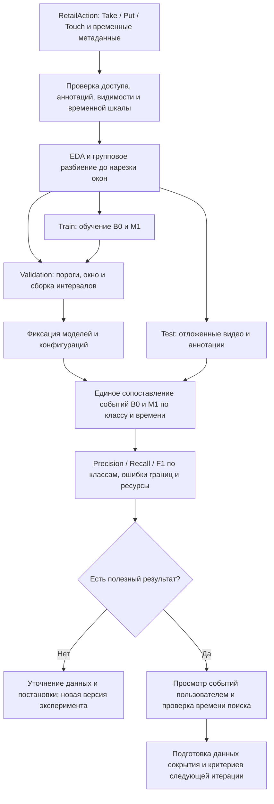
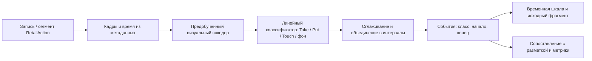
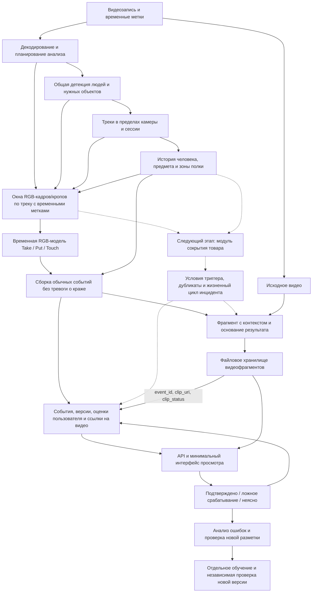

# ML System Design Doc — Видеоаналитика операционных процессов
## Дизайн ML системы - MVP 1

## 1. Цели и предпосылки

### 1.1. Зачем идём в разработку продукта?

**Бизнес-цель.** Помочь сотрудникам магазина быстрее находить и проверять эпизоды, связанные с потерями товаров и безопасностью людей. В перспективе потокового пилота — сократить время от наблюдаемого рискованного действия до проверки и реакции сотрудника.

Сейчас видео просматривают операторы и сотрудники безопасности либо используют записи после инцидента. При большом числе камер внимание ограничено; краткие действия с товаром легко пропустить, а поиск нужного момента в архиве требует времени. Системы учёта и противокражные средства дают дополнительный контекст, но не описывают все действия на видео.

**Почему ML может улучшить процесс.** Значение имеет последовательность действий: взять товар, осмотреть, вернуть либо переместить в сумку. Детектор человека или движение в кадре этого не различают. Временная модель позволяет выделять такие эпизоды и сокращать объём видео для просмотра. Пользователь проверяет вывод по исходному фрагменту и принимает решение о дальнейших действиях.

**Успех текущей итерации с точки зрения бизнеса:** на заранее выбранном проверочном материале пользователь получает доступные для просмотра события `Take / Put / Touch`, может найти и проверить соответствующий эпизод, а команда показывает воспроизводимую оценку качества и затрат обработки. Сравнение времени поиска и проверки с ручным просмотром проверяет полезность интерфейса. Эти результаты ещё не подтверждают предотвращение краж.

Связь этапов с ценностью:

| Этап | Проверяемая польза | Как проверяем |
|---|---|---|
| Взаимодействия с товарами | Найти нужные эпизоды без полного ручного просмотра | Качество событий и время выполнения одинаковой задачи поиска |
| Сокрытие товара | Отобрать эпизоды, требующие внимания сотрудника | Полнота, ложные инциденты на час и трудозатраты проверки |
| Потоковый пилот | Дать сотруднику время на полезную реакцию | Задержка, время реакции, подтверждённый результат вмешательства и стоимость эксплуатации |

### 1.2. Бизнес-требования и ограничения

#### Требования

Основные пользователи — сотрудник безопасности/проверяющий и руководитель магазина.

| ID | Требование | Покрытие текущей итерацией |
|---|---|---|
| БТ-1 | Загрузить запись, указать источник, задать нужные зоны и запустить обработку | Да, минимальный интерфейс или форма запуска задания |
| БТ-2 | Находить действия с товаром и показывать их время и доступную локализацию | Да, только `Take / Put / Touch` |
| БТ-3 | Показывать основание результата и видео достаточного качества для проверки | Да, временная шкала и карточка события с фрагментом |
| БТ-4 | Выделять рискованные эпизоды в отдельную ленту инцидентов | Предусмотреть формат; рабочий триггер сокрытия — следующий этап |
| БТ-5 | Сохранять оценки «подтверждено», «ложное срабатывание», «неясно» и комментарий | Да, для ручного разбора результатов; это не автоматическое переобучение |
| БТ-6 | Выгружать результаты и знать качество конкретной версии | Да, структурированная выгрузка и отчёт по классам |
| БТ-7 | Поддержать работу с IP-камерами и оперативную реакцию | За пределами текущей итерации; отдельная приёмка потокового пилота |

#### Ограничения

- Текущий этап работает с записями на собственном компьютере или сервере. Число потоков, GPU, бюджет и сроки пилота не определены; гарантий реального времени нет.
- Каждая камера анализируется независимо. Локальный трек не позволяет достоверно оценивать всё время пребывания человека в магазине или связывать его перемещения между камерами.
- Для обучения и проверки допустимы публичные датасеты и постановочные записи. Перед использованием фиксируются доступность, условия использования и происхождение материала.
- Неоплата требует кассового или иного проверенного контекста. Видеосигнал описывает действие; обычное взятие товара не становится тревогой о краже.
- Перекрытие предмета, пропуск кадров или потеря трека означают недостаток наблюдений. Их нельзя автоматически трактовать как сокрытие или отсутствие события.
- Агрессия в исходной постановке относится к визуальным признакам. Аудио и распознавание речи в текущую версию не входят.

#### Ожидания от итерации и процесс проверки

Результат итерации — воспроизводимый прототип `Take / Put / Touch`, сравнительный отчёт с бейзлайном и минимальная возможность просмотра результатов. Прототип не объявляется системой обнаружения краж.

Проверка проходит в два этапа:

1. **Офлайн-проверка.** DS фиксирует набор данных, разбиение и протокол, запускает бейзлайн и основную модель, сохраняет события, метрики и примеры ошибок. Время обработки измеряется на явно указанном оборудовании.
2. **Пользовательская проверка на записях.** Проверяющий решает одинаковую задачу поиска эпизодов вручную и с временной шкалой. Для сравнения используются сопоставимые задания с учётом эффекта повторного просмотра. Фиксируются время поиска, правильность результата и затраты на проверку. Затем пользователь просматривает карточки и даёт обратную связь.

В будущий потоковый пилот добавляются подключение камер, настройка зоны ответственности сотрудника, оперативные сигналы и регистрация реакции. Передача обратной связи в обучение выполняется отдельной итерацией после контроля разметки.

#### Критерии успеха пилота

Критерии разделяются по этапам; высокое качество обычных взаимодействий не заменяет проверку сокрытия.

| Критерий | Условие приёмки | Текущий статус |
|---|---|---|
| Качество взаимодействий | Отчёт по каждому классу на независимом тесте; основная модель сравнима с бейзлайном по качеству и ресурсам | Измерений нет; минимальные значения согласуют PO и DS до финальной проверки |
| Полезность просмотра | Пользователь выполняет задачу поиска; сравниваются время и правильность с ручным процессом | Требуются сценарии, участники и допустимое время проверки |
| Качество рискованных триггеров | Recall не ниже согласованного минимума при числе ложных инцидентов на камеру в час не выше согласованного предела | Применимо после появления разметки и модели сокрытия |
| Производительность | Зафиксированы оборудование, объём, разрешение, частота анализа и время обработки | Для файлов скорость может быть ниже реального времени |
| Готовность потокового пилота | Согласованы предел задержки, нагрузка на проверяющего и правила действий при сбоях | Не является результатом текущей итерации |

До согласования численных границ возможна демонстрация прототипа и отчёт о фактических результатах. Заявление об успешном операционном пилоте требует утверждённых критериев. При достаточном качестве следующий шаг — разметка и проверка сокрытия; при высоком числе ошибок — уточнение классов, данных и зон. Если ценность просмотра не подтверждается, пересматривается пользовательский сценарий до усложнения моделей.

### 1.3. Что входит в скоуп проекта/итерации, что не входит

#### Входит в текущую итерацию

- Подготовка доступного поднабора RetailAction: проверка аннотаций и времени кадров, исследовательский анализ качества данных (EDA), фиксированное разбиение и описание ограничений.
- Бейзлайн и основная временная модель для `Take / Put / Touch`; выдача интервалов и доступной локализации взаимодействия.
- Минимальная цепочка «запись → события → просмотр фрагмента → оценка пользователя → выгрузка» для БТ-1, БТ-2, БТ-3, БТ-5 и БТ-6. Для БТ-4 — структура инцидента без обещания работающего детектора сокрытия.
- Сравнение качества и ресурсов, анализ ошибок по классам и условиям съёмки. Все операции первого этапа возможны на подготовленных записях; непрерывный поток не требуется.

#### Не входит в текущую итерацию

Общий продуктовый список сохраняется как направления развития. Каждый сценарий требует собственного определения наблюдаемого события, данных и приёмки.

| Направление | Примеры из исходного описания | Почему отложено / необходимое условие |
|---|---|---|
| Сокрытие товара | Карман, сумка, рюкзак, пакет/шоппер, одежда, детская коляска | Следующий целевой триггер; нужны RGB-интервалы, похожие обычные действия и проверка видимости товара |
| Употребление продукции | Открытие упаковки, еда и питьё | Нужны последовательности действий; факт неоплаты устанавливается отдельно |
| Порча товаров и имущества | Бросание товара, разлив жидкости, удары по витрине или оборудованию | Раздельно размечаются действие и видимое повреждение; намерение не определяется автоматически |
| Безопасность людей | Драки, угрожающие жесты, самоповреждение, нож и огнестрельное оружие | Отдельные классы, данные и допустимые ошибки; визуальные жесты не подтверждают содержание речи |
| Положение человека | Длительное лежание или сидение на полу | Нужны определение поверхности, устойчивость трека и согласованный временной порог |
| Состояние камеры | Удар, закрытие обзора, изменение ракурса | Требуется отличать визуальное изменение от обрыва источника и освещения; намерение неизвестно |
| Доступ в зоны | Вход в кассовую или служебную область | Нужны геометрия зоны и правила допустимого доступа |
| Длительное пребывание | Долгое нахождение в отделе или магазине, частое оглядывание | Время локального трека не равно времени в магазине; «без цели» и «поиск камер» не следуют из движений |
| КСО | Пропуск сканирования товара | Требуются синхронизированные события кассы и правило связи с видео |

Также отложены межкамерное сопоставление людей, распознавание личности, производственные сценарии, полноценный аналитический дашборд, генеративные сводки и эксплуатация 24/7. Числа длительности из исходного README противоречат друг другу: для лежания указаны 5 и 10 секунд, для сидения — 10 и 30; для пребывания — разные интервалы. Они считаются кандидатами, а не принятыми требованиями.

#### Качество кода и воспроизводимость

В репозитории уже заданы Ruff (`ruff.toml`) и pre-commit (`.pre-commit-config.yaml`): линтинг с исправлением поддерживаемых ошибок и форматирование. Перед коммитом проверки должны проходить в установленном окружении.

Для каждого будущего эксперимента сохраняются версия кода, список и контрольные суммы данных, split, конфигурация, seed, версии зависимостей и весов, параметры кадров и зон, метрики и ошибочные примеры. Веса и видео хранятся вне Git, в отчёте указываются их идентификаторы. После реализации проверяются расчёт времени по метаданным, сопоставление событий, подавление дубликатов и полный проход небольшого видео до результата. Эксперименты должны запускаться по документированной команде; такой команды для модели пока нет.

#### Планируемый технический долг

| Что оставляем упрощённым | Что потребуется перед эксплуатацией |
|---|---|
| Один обработчик видео, простая очередь, файловое хранение и одна структурированная БД | Профилирование, устойчивое исполнение заданий, резервирование и масштабирование по измеренной нагрузке |
| Ручная подготовка данных и запуск экспериментов | Автоматизация проверок данных, учёт происхождения артефактов и регрессионные прогоны |
| Локальный доступ к прототипу | Разграничение доступа, журнал действий, правила хранения и удаления видео |
| Offline-обработка без гарантии скорости | Потоковый адаптер, буфер, контроль задержки и явная политика перегрузки |
| Ручное обновление модели с сохранением предыдущей версии | Управляемый выпуск, мониторинг качества и проверенный откат |

Разделение на микросервисы и выбор распределённого брокера откладываются до появления соответствующей нагрузки. Независимая проверка качества и контроль прав на данные не относятся к откладываемому долгу.

### 1.4. Предпосылки решения

1. **Информация находится во времени.** Для различения взятия, возврата и касания нужны последовательности кадров и история взаимодействия. Единица анализа — действие человека с предметом; выход — интервал события, а не только класс кадра.
2. **Начинаем с доступной наблюдаемой задачи.** По материалам подбора данных RetailAction содержит `Take / Put / Touch` с временной и пространственной разметкой. Это основание для первого эксперимента, но доступность выбранных файлов и пригодность аннотаций ещё нужно проверить загрузкой и EDA.
3. **Разные источники требуют разных временных шкал.** Для RetailAction используются выбранные кадры и их временные метаданные; равномерный FPS не предполагается. Для записи без календарного времени сохраняется относительное время в видео. Промежутки без анализа учитываются явно.
4. **Горизонт — распознавание наблюдаемого действия.** Прогноз будущей кражи и намерений не ставится. Длина временного окна и допустимое запаздывание выбираются на валидации; обработка записей может использовать полный фрагмент, потоковый вариант потребует отдельной причинной схемы без будущих кадров.
5. **Гранулярность — камера, сессия и событие.** Ключ трека включает источник, сессию и локальный ID. Два ракурса одного примера RetailAction можно использовать в исследованиях, но это не реализует связь людей между произвольными камерами магазина.
6. **Общие вычисления переиспользуются.** Детекция и трекинг выполняются один раз для совместимых кадров и версий. Позы, руки, предметы и дополнительные кропы запрашиваются только при необходимости; одних поз недостаточно для проверки перемещения мелкого товара.
7. **Доменный перенос требует отдельной проверки.** Качество на подготовленных сегментах, постановках и других помещениях нельзя автоматически переносить на непрерывные магазинные камеры. Положительные инциденты и длительное обычное видео нужны для разных сторон оценки.
8. **Человек остаётся в контуре.** Система отбирает материал для проверки. Уровень уверенности модели, достаточность наблюдений, факт просмотра и подтверждение действия хранятся раздельно. Обратная связь попадает в обучение после проверки и версионирования.

## 2. Методология

### 2.1. Постановка задачи

**Техническая задача:** распознавание и временная локализация действий человека с товаром в видео (temporal action detection). Для первой итерации классы ограничены `Take / Put / Touch`; в дальнейшем добавляются модули наблюдаемых рискованных действий. Это не единый классификатор «честный покупатель / нарушитель».

**Вход:** RGB-последовательность или запись, временные метки, идентификатор источника, доступные зоны и параметры анализа. Целевой участник и область оценки задаются протоколом. Готовые позы или локализация из аннотаций допустимы в отдельном компонентном эксперименте, но не подменяют предсказания в оценке полной цепочки.

**Выход события:** `event_id`, `source_id`, `session_id`, `event_type`, `start_s`, `end_s`, доступные участники и локализация, оценка модели, признаки недостаточной видимости, версия модели/конфигурации, ссылка на видеофрагмент. Для событий, создающих сигнал, отдельно сохраняются время выполнения условия и момент выдачи. Неизвестное значение остаётся неизвестным.

Обычные события отображаются на временной шкале. В будущем модуль `product_concealment` создаёт кандидат инцидента и, если данные позволяют, подтип `pocket`, `bag`, `backpack`, `shopping_bag`, `under_clothing`, `stroller` или `unknown`. Список реально поддерживаемых подтипов определяется экспериментом; он не следует из одного общего класса Shoplifting.

#### Бейзлайн и основная модель

| Вариант | Метод | Зачем нужен / ограничения |
|---|---|---|
| Пользовательский процесс без ML | Ручной поиск и просмотр эпизода | Сравнение времени и правильности выполнения задачи пользователем |
| Технический бейзлайн B0 | Признаки кадров из предобученного визуального энкодера → простой линейный классификатор `Take / Put / Touch` и фона → фиксированное сглаживание и сборка интервалов | Недорогая проверка полезности данных и протокола; слабый учёт порядка действий |
| Основной вариант M1 | Предобученная временная RGB-модель на окнах последовательности → дообучение под классы → локализация и сборка событий | Проверка пользы временной информации; конкретный backbone выбирается после пробного запуска и профилирования |
| Следующее расширение | Отдельный модуль сокрытия с доступом к RGB, истории человека и предмета | Не обучается из метки `Put`; нужны собственные интервалы и контрпримеры |

Для B0 параметры сглаживания и пороги подбираются только на валидации. Для M1 используется временная локализация с классификационной функцией потерь и, если модель предсказывает границы, отдельной ошибкой локализации. Веса классов, конкретная функция потерь и окно выбираются по EDA и валидации. Модели сравниваются при одинаковых данных, области оценки и сопоставлении событий. Более сложная модель принимается при измеримой пользе с учётом ресурсов; иначе сохраняется B0.

### 2.2. Блок-схема решения

#### Подготовка и проверка решения

**Разбиение данных.** Единица разбиения — исходная видеозапись либо группа связанных записей одного события. Все фрагменты одной записи, соседние и перекрывающиеся окна, а также оба ракурса одного примера остаются в одной части: train, validation или test. Разбиение выполняется до нарезки окон; состав групп и принадлежность к частям сохраняются для одинакового использования в B0 и M1.

**Разметка фона и область оценки.** Метка `фон` для B0 назначается только проверенным интервалам, в которых для целевого участника и области анализа подтверждено отсутствие `Take / Put / Touch`. Отсутствие аннотации само по себе не означает фон. Неполностью размеченные и неоднозначные интервалы доразмечаются либо заранее исключаются из обучения и расчёта метрик. Область и интервалы оценки фиксируются до запуска моделей; неразмеченные действия других людей не считаются автоматически ложными предсказаниями.

**Сопоставление событий.** Предсказания сравниваются с эталоном в пределах одного источника и области оценки по классу и временному пересечению; при наличии разметки также учитываются участник и локализация. Временное совпадение определяется через tIoU — длительность пересечения интервалов, делённую на длительность их объединения. Порог tIoU и правила пространственного соответствия фиксируются до сравнения моделей и одинаковы для B0 и M1. Предсказания обрабатываются по убыванию оценки модели; каждому выбирается ещё не сопоставленное эталонное событие с максимальным tIoU среди удовлетворяющих условиям. Одному эталонному событию соответствует максимум одно предсказание, и наоборот. Совпадения считаются TP, несопоставленные эталонные события — FN, несопоставленные предсказания в области оценки, включая дубликаты, — FP. По этим значениям рассчитываются precision, recall и F1 отдельно для каждого класса.

После анализа ошибок тест не используется для настройки той же отчётной версии. Если просмотр теста повлиял на разработку, следующий итоговый результат требует новой независимой проверки.

#### Архитектура технического бейзлайна B0

Область анализа и целевой участник фиксируются в протоколе. Если эксперимент использует готовую локализацию участника из датасета, его результат помечается как оценка компонента. Отдельный прогон с предсказанной локализацией нужен для оценки полной системы.

#### Архитектура основного MVP и подключение следующего триггера

Пунктир показывает расширение следующей итерации. Один блок на схеме не означает отдельный сервис. Для прототипа достаточно приложения/API, одного обработчика и общих хранилищ. При выборе модели без отдельного трекинга проверяется эквивалентная локализация взаимодействия; обязательность каждого дополнительного компонента определяется экспериментом.

В варианте с кропами окна собираются для одного трека с сохранением идентификаторов источника и сессии и временных меток кадров. История наблюдений используется при подготовке окон и сборке событий; временная RGB-модель получает только последовательность изображений. Для варианта с анализом целого кадра окна можно формировать без трекинга, а доступная локализация взаимодействия проверяется отдельно.

Видео связывается с событием через `event_id`. При создании события в БД сохраняется `clip_status = pending`; после подготовки фрагмента обработчик записывает `clip_uri` и статус `ready`, а при ошибке — `failed`. Интерфейс получает ссылку и состояние фрагмента из БД и показывает видео после его готовности.

Модули используют совместимые общие наблюдения, но сохраняют доступ к исходным последовательностям. Длительность рассчитывается по времени видео. Жизненный цикл рискованного события: кандидат → активное → завершённое; повторные наблюдения обновляют один эпизод, а самостоятельные действия не сливаются без правила. Потеря наблюдений обрабатывается явно, без вывода о завершении действия.
