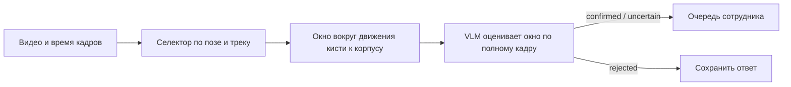
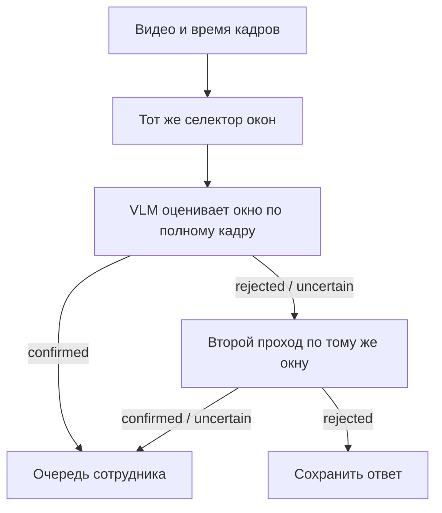
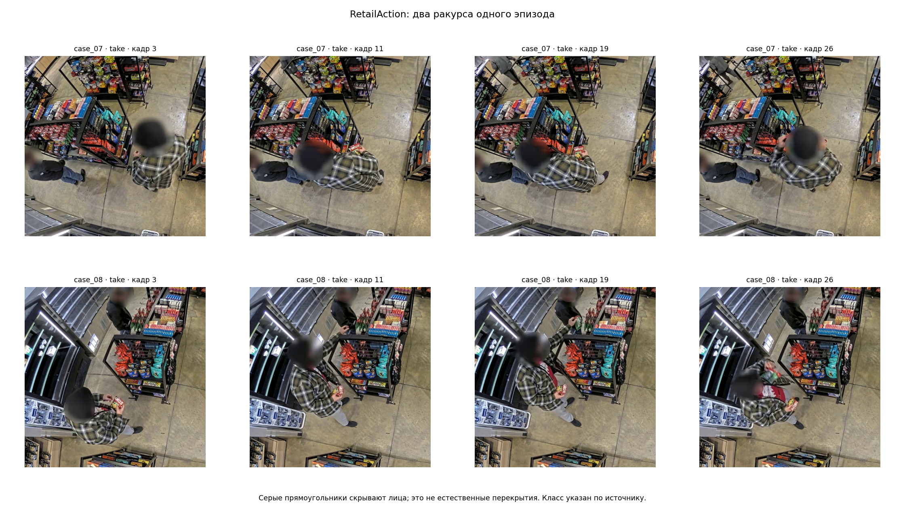

# ML System Design Doc — Видеоаналитика операционных процессов

## Дизайн ML-системы — MVP: обнаружение сокрытия товара

Документ описывает проектирование системы и план её проверки. Состав и ограничения исходных данных приведены в [отчёте EDA](eda/README.md).

## 1. Цели и предпосылки

### 1.1. Зачем идём в разработку продукта?

**Бизнес-цель:** сократить время поиска и проверки эпизодов возможного сокрытия товара. Сейчас сотрудник наблюдает за камерами или ищет событие в архиве. Система должна предложить фрагмент, указать участника и описать видимое действие; решение о реакции принимает человек.

ML планируется использовать для анализа последовательности действий. Визуально-языковая модель (VLM) рассматривается как средство предварительной разметки и распознавания сокрытия. Gemini — один из кандидатов, окончательный выбор будет сделан после проверки качества и затрат.

**Успех итерации:** воспроизводимый бейзлайн, сравнение с основным решением и проверка полезности для пользователя. Измеряем качество событий, ложные сигналы и время проверки. Снижение товарных потерь пока является гипотезой.

### 1.2. Бизнес-требования и ограничения

| ID | Требование | Планируемое покрытие |
|---|---|---|
| БТ-1 | Загрузить запись и задать параметры анализа | Обработка файлов, настройка зон при необходимости |
| БТ-2 | Находить признаки сокрытия и указывать участника и время | Основной сценарий MVP |
| БТ-3 | Показывать основание сигнала и видео для проверки | Карточка события с контекстом |
| БТ-4 | Выделять эпизоды, требующие внимания | Лента событий; недостаток информации отмечается отдельно |
| БТ-5 | Сохранять оценку пользователя и комментарий | Ручная проверка и анализ ошибок |
| БТ-6 | Выгружать результаты и знать качество версии | Отчёт, параметры обработки и версии моделей |
| БТ-7 | Работать с IP-камерами | Следующая итерация после проверки на записях |

**Ограничения:** видео не доказывает неоплату или намерение; камеры анализируются независимо; перекрытие объекта не подтверждает сокрытие. Внешняя VLM требует проверки условий передачи данных, стоимости и задержки. Оборудование, число потоков, бюджет и допустимая нагрузка на сотрудника уточняются до пилота.

**Процесс пилота:** сотрудник получает найденные эпизоды, смотрит видео и отмечает правильность результата. Сравниваем поиск с системой и ручной просмотр на сопоставимых заданиях. Конкретные пороги качества и времени согласуются с владельцем продукта (PO) до итоговой оценки.

**Основная метрика — полнота очереди на просмотр.** Из всех вручную размеченных сокрытий считаем долю тех, для которых сотрудник получит фрагмент с действием. В очередь включаем окна с итоговым статусом `confirmed` или `uncertain`. Предварительная цель — полнота не ниже 0,50. Отдельный ориентир для ложных подтверждений — не более 20% обычных тестовых интервалов хотя бы с одним `confirmed`. Допустимую нагрузку от всей очереди, включая неопределённые ответы, согласуем с владельцем продукта до итоговой проверки.

Планируем тест из 30 сокрытий и 30 обычных действий. Вместе с метриками указываем их неопределённость. На обычных интервалах отдельно измеряем долю интервалов, попавших в очередь. Для оценки числа лишних окон на час потребуются длительные размеченные записи с естественной частотой событий.

Для файловой обработки предварительный ориентир — не более 60 секунд на минуту видео. Он не подтверждён замерами и требует согласования; задержка потоковой камеры оценивается отдельно. Фиксируем оборудование, разрешение, настройки обработки, число окон, время сервиса и сети, а также стоимость на минуту исходного видео.

### 1.3. Что входит в скоуп проекта/итерации, что не входит

**Входит:** EDA, подготовка разметки с помощью VLM и человека, бейзлайн обнаружения сокрытия, оценка моделей, просмотр событий и отчёт. Взятие, возврат и касание товара используются как контекст и обычные действия для проверки ложных сигналов.

**Не входит:** доказательство кражи, контроль оплаты без кассовых данных, распознавание личности, межкамерное сопоставление и другие типы инцидентов. Эксплуатация 24/7 и гарантии реального времени отложены до проверки MVP.

**Качество и воспроизводимость:** фиксируем версии данных, разметки, моделей и инструкций, параметры обработки, результаты и ошибки. Код проверяется Ruff и pre-commit. Данные и веса хранятся отдельно от кода.

**Технический долг:** автоматизация сбора и контроля разметки, устойчивое исполнение заданий, усиление защиты и согласование сроков хранения, мониторинг и откат версий. Перед пилотом потребуется независимая проверка на данных целевого магазина.

### 1.4. Предпосылки решения

- Единица анализа — действие человека с предметом во времени. Отдельного кадра может быть недостаточно.
- Авторский класс Shoplifting не равен точной метке сокрытия; нужна проверка события, участника и временных границ.
- В полученном поднаборе RetailAction нет отдельного `touch` без других действий; это ограничение поднабора, а не всего корпуса. Метки обычных действий не заменяют разметку сокрытия ([EDA](eda/README.md)).
- VLM может ускорить разметку, но её ответы не считаются эталоном без контроля человеком.
- Видимость предмета, рук и места помещения влияет на распознавание. При недостатке наблюдений нужен неопределённый ответ.
- Временные метки и связанные ракурсы учитываются при подготовке данных; параметры контейнера не всегда отражают исходную съёмку.

## 2. Методология

### 2.1. Постановка задачи

Ищем фрагменты записи, на которых видно, как человек помещает товар в сумку, карман или под одежду. Сотрудник открывает фрагмент с контекстом и проверяет действие.

**Вход** — видео, временные метки кадров и доступные зоны анализа. **Выход** — границы окна в исходной записи, решение о направлении на просмотр, описание участника и наблюдаемого действия. Если видно место помещения товара, указываем его в описании. Технические ошибки регистрируем отдельно.

В бейзлайне селектор выделяет окна по позе и траектории человека. VLM оценивает каждое окно за один проход. В MVP тот же селектор и первый проход дополняем проверкой окон со статусами `rejected` и `uncertain`. Так на одних и тех же входах можно измерить, сколько событий второй проход вернёт в очередь и сколько дополнительных фрагментов получит сотрудник.

В качестве VLM планируем использовать [Gemini 3.5 Flash-Lite](https://ai.google.dev/gemini-api/docs/models).

### 2.2. Блок-схема решения

**Бейзлайн**

**Основной MVP — планируемое развитие**

Обе системы получают исходную запись. Ручную разметку используем для оценки после формирования очереди.

### 2.3. Этапы решения задачи

#### Этап 1. Подготовка данных

##### EDA

В [локальном отчёте](eda/README.md) представлены состав, объём, классы, характеристики видео и проблемы качества. Добавлены графики с выводами, [визуальный разбор исходных кадров](eda/visual_review.md) и скрипты пересборки.

**Вывод по примеру:** видимость рук и товара зависит от ракурса, а обычное взятие товара не подтверждает сокрытие. Два ракурса одного эпизода должны оставаться в одной части данных. Остальные примеры с перекрытиями и несколькими участниками приведены в визуальном разборе.

Снимок метаданных описывает 3582 видео из четырёх источников; по сохранённым статусам после исключения 3 точных дублей и 315 записей с проблемами временных меток остаётся 3264 технически пригодных видео. В репозиторий включены метаданные и примеры кадров со скрытыми лицами, полные видео хранятся отдельно. Просмотр 32 кадров из 8 видео показал простые офисные отрицательные примеры, мелкие/перекрытые предметы и несколько участников. Авторские классы и техническая пригодность не гарантируют видимость целевого сокрытия.

Основу выборки планируем составить из видео без исходного размытия лиц. RetailAction используем как дополнительный источник обычных взаимодействий с товаром. В нём лица размыты в исходных кадрах. Серые прямоугольники на лицах в иллюстрациях EDA добавлены при подготовке к публикации. Результаты по RetailAction показываем отдельно: если размытие встречается преимущественно в одном классе, модель может использовать его как подсказку.

Разметчик просматривает фрагмент целиком. Размытие лица допустимо, если можно проследить движение руки и товара до места помещения. Если маска на теле, перекрытие или пропуски кадров скрывают решающий момент, сохраняем фрагмент с пометкой «недостаточная видимость». Для отрицательной метки требуется различимое обычное действие. Доля содержательно пригодных фрагментов во всём корпусе пока неизвестна.

**Целевые переменные**

| Название данных | Есть ли данные / источник | Требуемые роли | Проверено ли качество |
|---|---|---|---|
| Наличие сокрытия и временной интервал | Ручная разметка событий на выбранных участках видео | DS, разметчик | Для эталона проверяем видимость действия и отмечаем его начало и конец |
| Участник и место помещения | Человек и место, различимые в исходном видео | Разметчик, DS | Для каждого события фиксируем, какие детали можно установить |
| Обычные действия и отсутствие сокрытия | Есть кандидаты в публичных данных; нужна проверка полных интервалов | Разметчик | Нет: отсутствие метки не означает отрицательный класс |

**Входные данные и признаки**

| Название данных | Есть ли данные / источник | Требуемые роли | Проверено ли качество |
|---|---|---|---|
| RGB-видео и кадры | Выбраны четыре источника; локально есть метаданные и примеры кадров | DS / инженер данных | Есть выборочный визуальный разбор; пригодность всех записей не подтверждена |
| Время, разрешение, число кадров, группы исходников | Да: локальный снимок метаданных EDA | DS | Частично: проблемы выделены; независимость сцен не подтверждена |
| Рамки людей, траектории, признаки взаимодействия | Детектор позы и трекер выделяют участника по исходным кадрам | ML Engineer | Проверяем непрерывность трека и соответствие участнику действия |

**Получение данных:** пакетная загрузка MP4 и авторских аннотаций, проверка файлов и метаданных, выделение связанных групп. Разметку приводим к структурированному формату с классом, участником и временными границами. Новые записи и разметка добавляются версиями по мере развития проекта; регулярный поток данных пока не задан.

**Предразметка.** VLM предлагает описание действия и участника с привязкой наблюдений ко времени окна. Человек проверяет каждый пример, используемый для обучения или настройки, и при необходимости исправляет метку. Сохраняем исходный ответ, версию инструкции и результат проверки. Пустой ответ, сбой сервиса или `rejected` сами по себе не служат основанием исключить фрагмент или присвоить ему отрицательную метку.

Группы исходных записей разделяем до нарезки окон и предразметки. Для проверки полноты заранее выбираем записи или непрерывные участки. Разметчик просматривает их целиком без подсказок селектора и VLM, отмечает видимые сокрытия, их границы и участников. Такой просмотр охватывает и моменты, для которых система не предложила окна. На остальном видео с неполной разметкой число пропусков неизвестно. Для оценки качества самой предразметки выделяем отдельную ручную выборку.

**Объём дополнительной разметки:** планируем 100 интервалов ручного эталона: 40 для валидации и 60 для теста, поровну сокрытий и обычных действий. Примеры для настройки дополнительно готовятся с помощью VLM и проверяются человеком. Тест содержит по 30 примеров каждого класса: при независимых наблюдениях это даёт ориентир полуширины 95%-го интервала Уилсона до 16,85 п.п. для полноты очереди и доли обычных интервалов с ложным подтверждением. [Расчёт и правила набора](eda/annotation_plan.md). Это план, а не готовый набор или гарантия точности.

**Достаточность и риски:** интервалы сначала отбираем из имеющегося пула. При нехватке видимых сокрытий, сложных отрицательных примеров или независимых групп добавляем новые записи; квоту не заполняем дублями. На тест ориентируемся минимум на 30 исходных групп. Зависимость внутри сцен требует оценки неопределённости по группам и при необходимости увеличения объёма. Ложные сигналы в час и редкие подтипы потребуют отдельной проверки.

**Конфиденциальность:** на видео могут быть идентифицирующие детали. Исходники и фрагменты хранятся вне Git; доступ ограничивается ролями и журналируется, данные шифруются при хранении и передаче. Для прототипа предлагается удалять временные кропы не позднее 7 дней, исходники и фрагменты — не позднее 30 дней, с учётом производных и резервных копий. Сроки предварительные и согласуются с владельцем данных и применимыми требованиями. Проверяем права на использование и публикацию, обезличиваем демонстрационные материалы при необходимости. Перед передачей внешней VLM отдельно проверяем разрешение на передачу, условия хранения у провайдера и возможность удаления.

**Бейзлайн / MVP:** исходники и правила разделения общие. Для бейзлайна нужен небольшой проверенный набор; для MVP — расширение предразметки с ручным контролем и покрытием сложных случаев.

**Результат:** проверенный реестр, протокол разметки, отдельные обучающая/валидационная/тестовая части и оценка качества VLM-предразметки. Состав и ограничения каждого набора задокументированы.

#### Этап 2. Подготовка прогнозных моделей

| Техника | Бейзлайн | MVP |
|---|---|---|
| Модель | Один проход VLM | Второй проход VLM по тому же окну при необходимости |
| Вход | Окна селектора с исходным временем, полный кадр | Те же окна для сравнения вклада второго прохода |
| Настройка | Базовая инструкция и параметры из этапов 3–4 | На валидации сравниваем инструкции и правило направления на просмотр |

**Выборки — общие для этапов 2–6:** связанные записи, окна и ракурсы остаются в одной части. Дополнительные примеры VLM с проверкой человеком используются для настройки и возможного обучения; ручные валидация и тест — для выбора настроек и итоговой проверки соответственно. План ручного эталона — 40/60 интервалов, поровну двух классов в каждой части. Сохранение групп важнее точных пропорций; при необходимости объём увеличивается и фиксируется до теста. Случайное разбиение соседних кадров не применяется. Валидация и тест размечаются вручную без ответов оцениваемой VLM.

**Горизонт и гранулярность.** Система анализирует доступную запись по мере поступления файлов и выдаёт решение по каждому окну. Настройки и модели обновляем после проверки новой версии.

**Полнота очереди.** Для каждой записи сопоставляем окна очереди с эталонными событиями, если длительность их временного пересечения больше нуля. Выбираем максимальное число пар один к одному. Полнота равна числу пар, делённому на число всех размеченных событий, включая пропущенные селектором. Если одно окно захватывает два события, оно даёт максимум одну пару. Точность очереди (precision) — доля её окон, вошедших в такие пары. Оставшиеся окна, в том числе повторы, учитываем как лишние в полностью размеченной области.

Дополнительно приводим F1 для состава тестовой выборки и долю неопределённых ответов по обоим классам. Совпадение окна по времени показывает, что сотруднику доступен эпизод. Правильность описания участника, товара, действия и места помещения сверяем по видео отдельно.

**Функция потерь и выбор настроек.** В первой итерации веса моделей фиксированы, обучение не требуется. На валидации максимизируем полноту очереди при ограничениях на ложные подтверждения и нагрузку сотрудника (§ 1.2). При достаточном объёме разметки для обучения классификатора окон рассмотрим кросс-энтропию с весами классов.

**Развитие и интерпретация:** сравниваем модели, длительность контекста и способы представления взаимодействия, меняя один фактор за раз. Разбираем ложные и пропущенные события по видимости товара, участнику, ракурсу и перекрытиям. Ответ VLM проверяется по видео; текстовое объяснение не считается доказательством.

**Риски и бизнес-проверка:** малый эталон, ошибки предразметки, нестабильные ответы и перенос между сценами. Снижаем их ручным тестом, групповым разбиением и фиксацией версий. Проверяющий подтверждает определения событий и разбирает примеры ошибок.

**Результат:** воспроизводимое сравнение полноты очереди бейзлайна и MVP на одних записях. Для каждой конфигурации указываем ложные подтверждения, нагрузку на сотрудника, задержку и стоимость.

#### Этап 3. Формирование окон и выбор участника

**Селектор для обеих систем.** По каждому исходному кадру оцениваем позу человека и связываем наблюдения в трек. Когда кисть приближается к области корпуса, берём **2 с до срабатывания и 3 с после**. На краю записи используем весь доступный контекст. Шаг между окнами зависит от движений человека. Для повторного срабатывания по одному треку должно пройти **не менее 4 с** и кисть должна снова отойти от корпуса и приблизиться к нему. Пересекающиеся окна одного трека в одной записи объединяем с сохранением всех срабатываний. Итоговый фрагмент поэтому может быть длиннее 5 с.

**Подготовка видео.** В окно включаем исходные кадры в порядке их временных меток. Для разреженных последовательностей RetailAction берём авторское время каждого кадра. В VLM передаём видео окна с полным полем кадра и запрашиваем **5 кадров/с**. На валидации рассматриваем также 10 и 15 кадров/с на тех же видеовходах. Фиксируем частоту, указанную в запросе: конкретные кадры, обработанные внешним сервисом, могут быть неизвестны.

**Полнота селектора.** Окно подходит для сопоставления, если покрывает не менее 50% длительности вручную размеченного действия. Делим длительность пересечения на длительность действия. Например, если окно длиной 5 с целиком содержит секундное сокрытие, покрытие равно 100%, а tIoU — 0,2. Для оценки отбора достаточно того, что действие доступно для просмотра. Назначаем окна событиям один к одному с максимальным числом пар, затем делим число пар на число всех размеченных событий.

**Риски.** Движение кисти может быть скрыто, а трек — прерваться или переключиться на другого человека. Разбираем события без окна и отдельно сверяем участника трека с человеком в разметке.

**Результат:** правила подготовки окон, оценка их потерь и достаточный контекст для распознавания. Данные, горизонт и обновления — по общим правилам этапа 2.

#### Этап 4. Проверка события и бизнес-правила

| Бейзлайн | MVP |
|---|---|
| Для каждого окна сохраняем решение VLM | Для `rejected` и `uncertain` проверяем во втором проходе видимость товара и движение руки к месту помещения. При `confirmed` сохраняем решение VLM |

**Формат ответа VLM.** Запрашиваем JSON со следующими полями:

| Поле | Содержание |
|---|---|
| `decision` | `confirmed` — модель видит помещение товара, `rejected` — отклоняет гипотезу, `uncertain` — наблюдений недостаточно |
| `participant` | Описание человека, чьи действия оценивает модель |
| `observations` | Список наблюдений, каждое содержит время `time_s` в секундах от начала окна и текст `description` |
| `reason` | Видимое основание решения |
| `limitations` | Список ограничений видимости |

Временные точки помогают проверяющему найти описанный момент. Границы показываемого фрагмента задаёт селектор. Для воспроизведения сохраняем идентификатор исходника и трека, границы окна, временные метки кадров, версию модели, инструкцию, схему ответа, параметры запроса и исходный ответ.

**Проверка решения.** По итоговому статусу `confirmed` или `uncertain` ставим окно в очередь. При технической ошибке сохраняем фрагмент и статус сбоя для разбора. Отдельно проверяем, верно ли модель описала человека и место помещения и не приняла ли обычное действие за сокрытие.

**Результат:** события с фрагментами и основанием решения; правила согласованы с проверяющим. Настройка ведётся на валидации, итоговые показатели — на тесте.

#### Этап 5. Инференс и сквозная оценка

| Бейзлайн | MVP |
|---|---|
| Последовательная обработка файла и сохранение событий | Выбранные компоненты, состояния заданий, контроль ошибок и связанная выдача видео/результатов |

**Метрики.** На одних и тех же записях сравниваем полноту селектора, полноту и точность очереди, долю обычных интервалов с ложным подтверждением, время обработки, память и стоимость. На длительных полностью размеченных записях также рассчитываем число лишних окон на час.

Для сквозной оценки подаём исходные записи или заранее заданные непрерывные участки, размеченные по правилам этапа 1. Событие остаётся в знаменателе полноты и при отсутствии срабатывания, и при сбое обработки. Отдельно показываем качество VLM на заранее выбранных окнах: такая проверка оценивает только распознавание на готовом входе. Границы области оценки фиксируем до теста.

Время измеряем от подготовки видео и окон до сборки событий и подготовки фрагментов, включая запросы к сервису и ожидание ответов. Окно, частоту кадров и область взаимодействия выбираем на валидации с учётом качества, времени и стоимости. Если решение слишком медленное или дорогое, профилируем этапы, затем проверяем отбор окон, сокращение числа кадров или другую модель и повторно оцениваем пропуски и ресурсы.

**Риски и бизнес-проверка:** сбои модели или сервиса не означают отсутствия события. Сохраняем технические ошибки и возможность ручного просмотра. Проверяем, что сотрудник открывает нужный фрагмент и видит статус обработки. Замер на готовом файле не объявляется задержкой камеры.

**Результат:** запускаемая цепочка, инструкция воспроизведения и отчёт о качестве/ресурсах. Режим обработки и обновления — по этапу 2; потоковый режим проверяется отдельно.

#### Этап 6. Пользовательская проверка и итоговый отчёт

| Бейзлайн | MVP |
|---|---|
| Выдача базовой модели; ручной просмотр как контроль процесса | Просмотр событий выбранного решения с видео и основанием сигнала |

**Проверка:** сопоставимые задания на репрезентативных записях без преимущества от повторного просмотра. Измеряем правильность и время поиска/проверки; цель — время ниже бейзлайна при правильности не ниже него. Новая ML-целевая переменная не вводится.

**Риски:** маленькая выборка и показ только удачных случаев. PO получает общий отчёт, пропуски и ложные сигналы. Результаты не переносятся на новые магазины без отдельного теста.

**Результат:** согласованный отчёт с ограничениями и решением о следующей итерации. Проверка повторяется после существенного изменения модели или сценария; бизнес-эффект не объявляется измеренным заранее.
